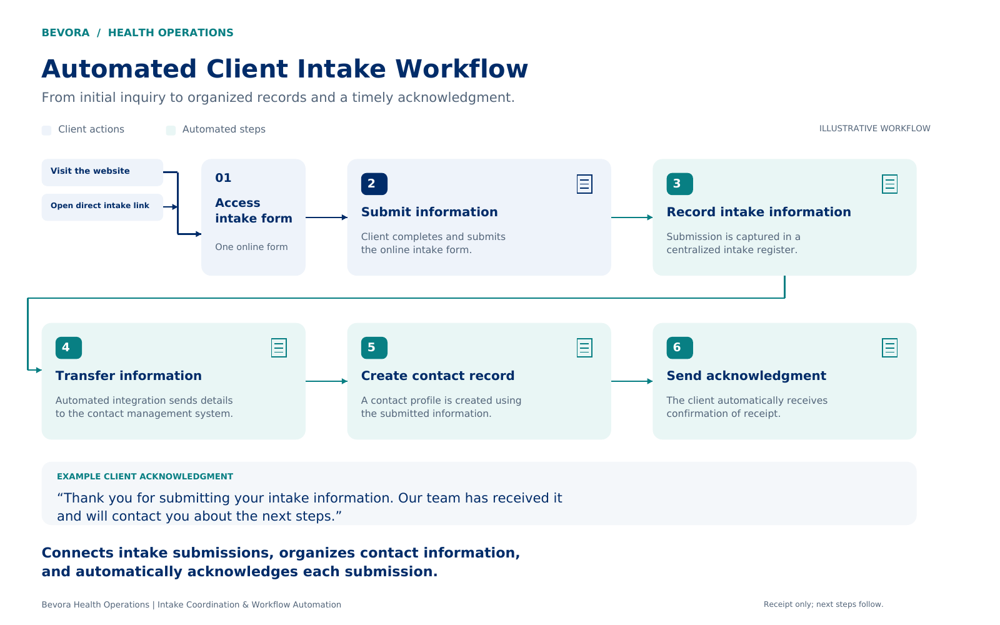
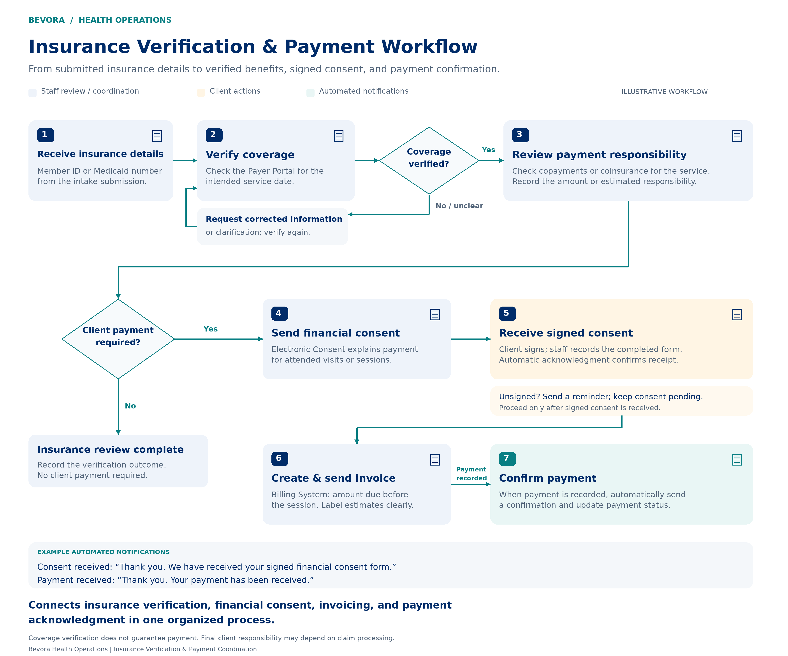

# Bevora Health Operations

## Systems & Workflow Portfolio

A growing collection of administrative workflows that connect client inquiries, organized information, and timely follow-up.

### 01 · Intake Workflow

**Automated Client Intake** connects an online intake form to a centralized intake register and contact management system, then automatically acknowledges the submission.

### 02 · Insurance Verification & Payment

Connects coverage verification, client payment responsibility, signed financial consent, invoicing, and payment acknowledgment.

---

Bevora Health Operations | Intake Coordination & Workflow Automation

Illustrative workflows use generic system labels and contain no client data.
